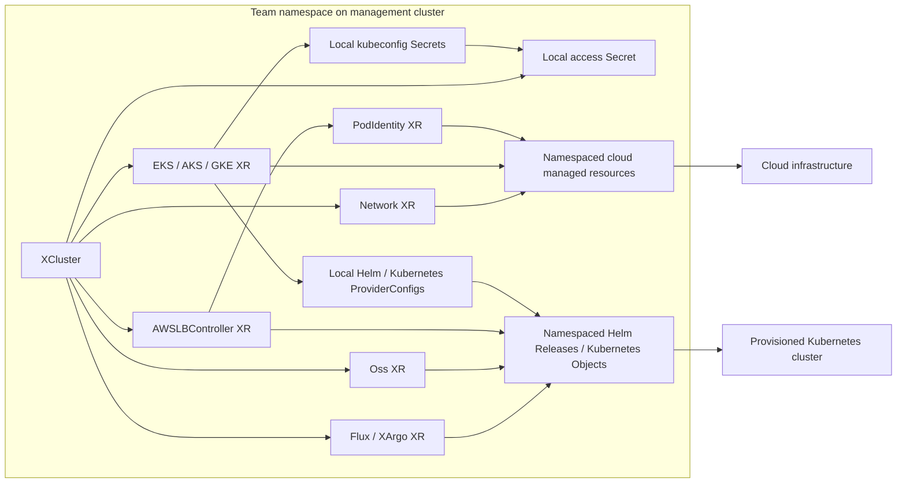

# Namespaced Cluster-as-a-Service on OSS Crossplane v2

This Configuration provides a namespaced Kubernetes API for provisioning EKS,
AKS, and GKE clusters with networking, Flux or Argo CD, and Prometheus. It runs
on upstream [Crossplane](https://docs.crossplane.io/latest/) v2.4 or later and
bundles the cloud, network, and add-on APIs in one installable package.

Users create an `XCluster` in their team's namespace. Every composed XR, managed
resource, provider configuration, and kubeconfig Secret stays in that namespace.
The package uses namespaced v2 provider APIs and explicitly selects local
`ProviderConfig` resources. Managed control planes, Spaces, robots, teams, and
MCP connectors are outside its scope.

## Architecture



The [XCluster XRD](apis/definition.yaml) uses `apiextensions.crossplane.io/v2`
and `scope: Namespaced`. There is no separate claim. All eleven bundled dependency
APIs use the same scope; cloud resources use the providers' `.m.` API groups.
Namespaced `Usage` resources preserve deletion ordering.

The management namespace and workload namespace are separate concepts. A Helm
Release in `team-a` can install Flux into `flux-system` on its target cluster.
The package pins Helm provider v1.2.0, which supports that target namespace field.
Kubernetes Objects similarly manage manifests in the remote cluster.

## Bundled APIs and sources

| Area | APIs | Source |
| --- | --- | --- |
| AWS | Network, EKS, AWSLBController, PodIdentity | [Network](https://github.com/upbound/configuration-aws-network), [EKS](https://github.com/upbound/configuration-aws-eks), [LB controller](https://github.com/upbound/configuration-aws-lb-controller), [Pod Identity](https://github.com/upbound/configuration-aws-eks-pod-identity) |
| Azure | Network, AKS | [Network](https://github.com/upbound/configuration-azure-network), [AKS](https://github.com/upbound/configuration-azure-aks) |
| GCP | Network, GKE | [Network](https://github.com/upbound/configuration-gcp-network), [GKE](https://github.com/upbound/configuration-gcp-gke) |
| GitOps | Flux, XArgo | [Flux](https://github.com/upbound/configuration-gitops-flux), [Argo CD](https://github.com/upbound/configuration-gitops-argocd) |
| Observability | Oss | [Observability](https://github.com/upbound/configuration-observability-oss) |

The upstream configurations are the starting point for the bundled implementations.
Their exact source revisions are recorded in [third_party/sources.json](third_party/sources.json),
and their Apache-2.0 licenses are retained in [third_party/licenses](third_party/licenses/).
Azure Network combines the current v2 API with its earlier KCL implementation;
Argo CD is adapted from its legacy API. The other components start from upstream
namespaced implementations.

These APIs are maintained locally in `apis/<component>` and `functions/<component>`.
Changes include portable KCL dictionaries, namespaced resource output, local
credential lookup, removal of Argo CD's Upbound CLI containers, and readiness
retention. The API groups retain the upstream `*.platform.upbound.io` names;
those names require no Upbound account or managed control plane.

[`apis/crossplane.yaml`](apis/crossplane.yaml) pins the cloud providers, Helm and
Kubernetes providers, `function-kcl`, and `function-auto-ready`. All packages are
referenced through the community registry at `xpkg.crossplane.io`. There are no
external Configuration dependencies or generated Upbound development models.

## Install and use

Install OSS Crossplane v2.4 or later using the [upstream installation guide](https://docs.crossplane.io/latest/get-started/install/).
Build and publish this package to an OCI registry you control (see Development),
then install the published image:

```yaml
apiVersion: pkg.crossplane.io/v1
kind: Configuration
metadata:
  name: configuration-caas
spec:
  package: ghcr.io/YOUR_ORG/configuration-caas:v0.1.0
```

Wait for the Configuration and its provider/function dependencies to become healthy:

```sh
kubectl get configurations,providers,functions
kubectl apply -f examples/management/prerequisites.yaml
```

The prerequisites create the example `team-a` namespace and grant Crossplane
permission to read provider kubeconfigs and compose native access Secrets. For each
team, create a namespace and cloud credentials there. Configure local namespaced
cloud ProviderConfigs using [examples/management/providerconfigs.yaml](examples/management/providerconfigs.yaml)
as a template. Apply only the cloud(s) you use, supply their credentials Secrets,
and replace the GCP project placeholder. Workload identity can be used instead
where supported by your management cluster and provider.

Customize a cluster example's namespace, cloud region, supported Kubernetes
version, AWS IAM principal, Git repository, and chart versions, then apply it:

```sh
kubectl apply -f examples/flux/aws-cluster.yaml
# Alternatives: examples/flux/{azure,gcp}-cluster.yaml
#               examples/argocd/{aws,azure,gcp}-cluster.yaml
kubectl get xclusters.caas.upbound.io -n team-a
crossplane resource trace xcluster.caas.upbound.io/caas-aws-flux -n team-a
```

Use unique cloud identifiers where the cloud requires them. Management resource
names and ProviderConfig names may be reused in different team namespaces;
namespace isolation does not make globally unique cloud names reusable.

## Cluster API

| Parameter | Meaning |
| --- | --- |
| `cloud` | `aws`, `azure`, or `gcp` |
| `id` | Cluster identifier used by cloud resources and local ProviderConfigs |
| `region` | Cloud region |
| `version` | Kubernetes version supported by the selected cloud |
| `nodes.count`, `nodes.instanceType` | Node pool size and machine type |
| `providerConfigName` | Local cloud credentials configuration; defaults to `default` |
| `deletionPolicy` | `Delete` or `Orphan`; translated to provider management policies |
| `iam.roleArn`, `iam.userArn` | Optional AWS administrator principal; role takes precedence |
| `network.subnets` | Optional AWS subnet CIDRs, types, and availability zones |
| `gitops` | Operator, Git source, and optional Argo CD ingress/OIDC settings |
| `operators` | Prometheus and selected GitOps Helm chart versions |

Default AWS subnets use zones `a` and `b` of the requested region. Supply
`network.subnets` when your account or region uses different zones.

AWS add-ons wait for the Load Balancer Controller, which waits for EKS. Azure and
GCP add-ons wait for their clusters. Existing add-ons remain desired when
prerequisites temporarily lose readiness. The bundled GKE composition also retains
its existing cluster when the service account temporarily loses readiness.

`spec.writeConnectionSecretToRef.name` selects the local access Secret name;
the default is `<id>-kubeconfig`. The field has no namespace override. The
composition requests the local Helm ProviderConfig and its provider-generated
Secret, copies the kubeconfig, propagates updates, and preserves the last value
during a temporary source outage. Cross-namespace credential references are rejected.
The Secret is owned by the XR and deleted with it, including when cloud resources
are orphaned.

```sh
kubectl get secret caas-aws-flux-kubeconfig -n team-a \
  -o jsonpath='{.data.kubeconfig}' | base64 --decode > kubeconfig
```

## Development

Install the Crossplane CLI v2.4.0 or later, Python 3, PyYAML, yamllint, and Docker:

```sh
python3 -m venv .venv
. .venv/bin/activate
pip install -r tests/requirements.txt yamllint
make generate
make test
make build
```

Edit `functions/<component>/main.k`, then run `make generate` to refresh the
embedded source in each packaged Composition. `make check` detects stale output
and lints YAML. `make build` writes `_output/configuration-caas.xpkg` using
`crossplane xpkg build`.

Tests run the real OSS function pipeline with `crossplane composition render`. They cover
all six cloud/operator combinations, the eleven bundled APIs, namespace isolation
with duplicate identifiers, cross-namespace credential rejection, provisioning
stages, ordering, readiness failures, schema defaults, and Secret routing/rotation.
They require no cloud credentials. Render one example with:

```sh
crossplane composition render examples/flux/aws-cluster.yaml \
  apis/composition.yaml examples/functions.yaml --xrd=apis/definition.yaml
```

CI builds an installable artifact and runs these tests. Publishing is explicit;
authenticate using your registry's normal Docker login workflow, then run:

```sh
crossplane xpkg push --package-files=_output/configuration-caas.xpkg \
  ghcr.io/YOUR_ORG/configuration-caas:v0.1.0
```

Cloud end-to-end validation requires your management cluster and cloud credentials.
Apply a customized example, wait for `Ready`, verify kubeconfig access and the
GitOps/Prometheus deployments, then delete the XR and verify cloud cleanup. Local
rendering and schema validation do not prove successful cloud provisioning.

## Migration

This package targets new namespaced installations. `Cluster` claims and
cluster-scoped `XCluster` resources are replaced by namespaced `XCluster` resources.
Crossplane controls live under `spec.crossplane`; access Secrets and cloud
credentials are local to the XR namespace. There is no `upbound-system`
compatibility namespace, `provider-upbound`, `XControlPlane`, or `XConnector`.

An established XRD's scope cannot be changed in place. Keep an existing
cluster-scoped installation on its previous package while migrating workloads to a
separate namespaced installation. Removing API files from this repository does not
clean up previously provisioned MCPs, connectors, or cloud resources.
